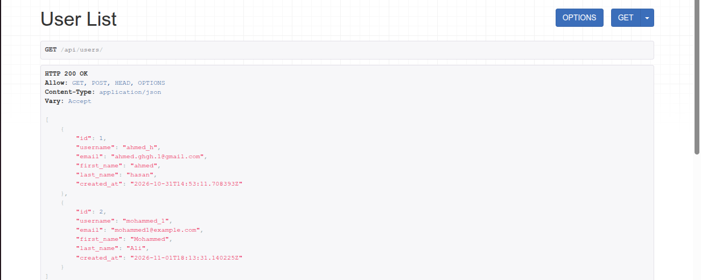
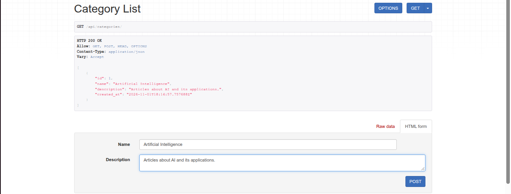
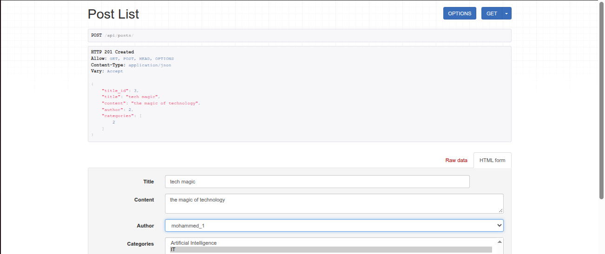
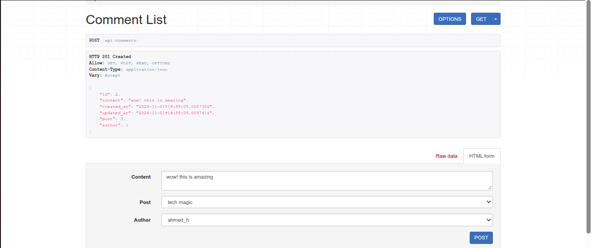
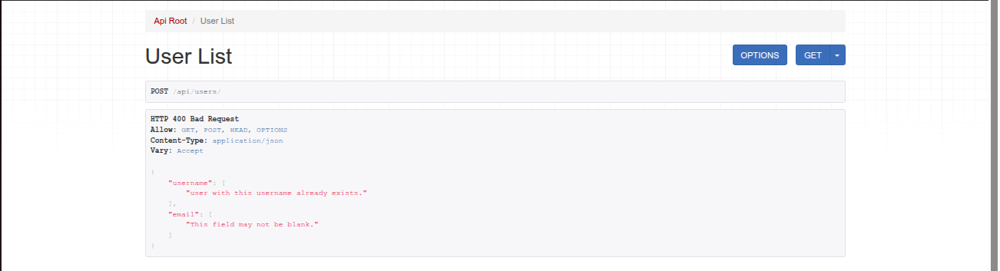

# Blog API – POST Endpoints

## Task Overview

This task focuses on implementing RESTful POST endpoints for a Blog Application using **Django REST Framework**.

The API allows clients to create users, categories, posts, and comments, with proper data validation and relationship handling.

## Implemented Endpoints

| Method | Endpoint | Description |
|---|---|---|
| POST | `/api/users/` | Create a new user |
| POST | `/api/categories/` | Create a new category |
| POST | `/api/posts/` | Create a new post |
| POST | `/api/comments/` | Create a new comment |

## Validation & Error Handling

The API implements the following validations:

- Username uniqueness.
- Email format validation.
- Category name uniqueness.
- Required field validation.
- Foreign key validation for authors and posts.
- Many-to-many relationship validation for post categories.
- Meaningful validation error messages.

## Screenshots

### 1. Users API

### 2. Categories API

### 3. Posts API

### 4. Comments API

### 5. Some Validation Errors

## Technologies Used

- Python
- Django
- Django REST Framework
- SQLite

## HTTP Status Codes

| Status Code | Description |
|---|---|
| 201 Created | Resource created successfully |
| 400 Bad Request | Validation error or invalid related object |
| 500 Internal Server Error | Unexpected server error |
