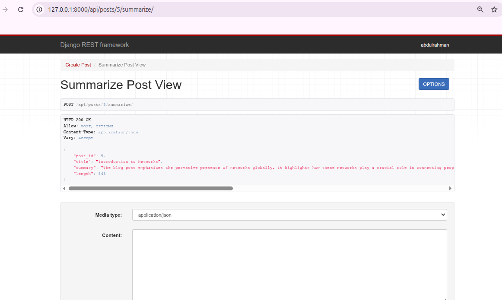

**# Blog Application – Models and API Development**

**## Task 1: Blog Application Models**

**\*\*Task Overview\*\***

This task focuses on creating the main database models for a Blog Application using Django ORM.

**\*\*Implemented Models\*\***

\- **\*\*User:\*\*** Stores user information, including username, email, first name, last name, and creation date.
\- **\*\*Category:\*\*** Stores category information, including name, description, and creation date.
\- **\*\*Comment:\*\*** Stores comment content, creation date, and last update date.

**\*\*Implementation Requirements\*\***

\- Define the required model fields and their appropriate data types.
\- Apply unique constraints where required.
\- Use automatic timestamps for creation and updates.
\- Implement \`\_\_str\_\_()\` methods for readable model representations.
\- Keep the models independent without adding relationships at this stage.

**\*\*Expected Output\*\***

Three Django models (\`User\`, \`Category\`, and \`Comment\`) successfully created, with their required fields, constraints, and database migrations.

\---

**\*\*# Blog API – POST Endpoints\*\***

**\*\*## Task Overview\*\***

This task focuses on implementing RESTful POST endpoints for a Blog Application using **\*\*\\\*\\\*Django REST Framework\\\*\\\*\*\***.

The API allows clients to create users, categories, posts, and comments, with proper data validation and relationship handling.

**\*\*## Implemented Endpoints\*\***

\| Method | Endpoint | Description |
\|---|---|---|
\| POST | \`/api/users/\` | Create a new user |
\| POST | \`/api/categories/\` | Create a new category |
\| POST | \`/api/posts/\` | Create a new post |
\| POST | \`/api/comments/\` | Create a new comment |

**\*\*## Validation & Error Handling\*\***

The API implements the following validations:

\- Username uniqueness.
\- Email format validation.
\- Category name uniqueness.
\- Required field validation.
\- Foreign key validation for authors and posts.
\- Many-to-many relationship validation for post categories.
\- Meaningful validation error messages.

**\*\*## Screenshots\*\***

**\*\*### 1. Users API\*\***
![Users API]\(screenshots/users.png)

**\*\*### 2. Categories API\*\***
![Categories API]\(screenshots/categories.png)

**\*\*### 3. Posts API\*\***
![Posts API]\(screenshots/posts.png)

**\*\*### 4. Comments API\*\***
![Comments API]\(screenshots/comments.png)

**\*\*### 5. One of the Validation Errors\*\***
![Validation Errors]\(screenshots/validation_error.png)

**\*\*## HTTP Status Codes\*\***

\| Status Code | Description |
\|---|---|
\| 201 Created | Resource created successfully |
\| 400 Bad Request | Validation error or invalid related object |
\| 500 Internal Server Error | Unexpected server error |

---

**# Task 3: AI-Powered Blog Post Summarization**

**## Task Overview**

This task focuses on implementing an AI-powered feature that summarizes existing blog posts using OpenAI and Django REST Framework.

**## Implemented Endpoint**

| Method | Endpoint | Description |
|---|---|---|
| POST | `/api/posts/<post_id>/summarize/` | Generate a summary for an existing blog post |

**## Implementation**

- Implemented a layered architecture (View → Service → Client).
- Reused the shared `ContentClient` for OpenAI integration.
- Retrieved existing posts from the database.
- Validated post IDs and post content.
- Generated concise summaries using OpenAI.
- Limited summaries to a maximum of 500 characters.
- Implemented error handling for invalid input and missing posts.

**## Screenshots**

### 1. AI Post Summarization API

**## HTTP Status Codes**

| Status Code | Description |
|---|---|
| 200 OK | Summary generated successfully |
| 400 Bad Request | Invalid post ID or empty post content |
| 404 Not Found | Requested post does not exist |